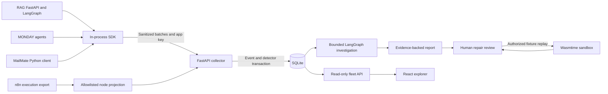
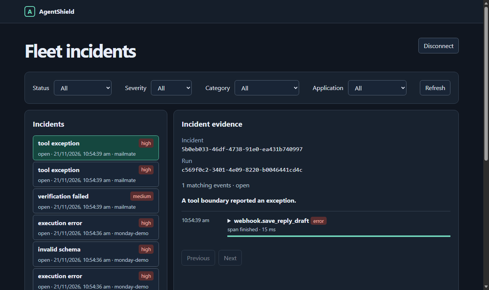
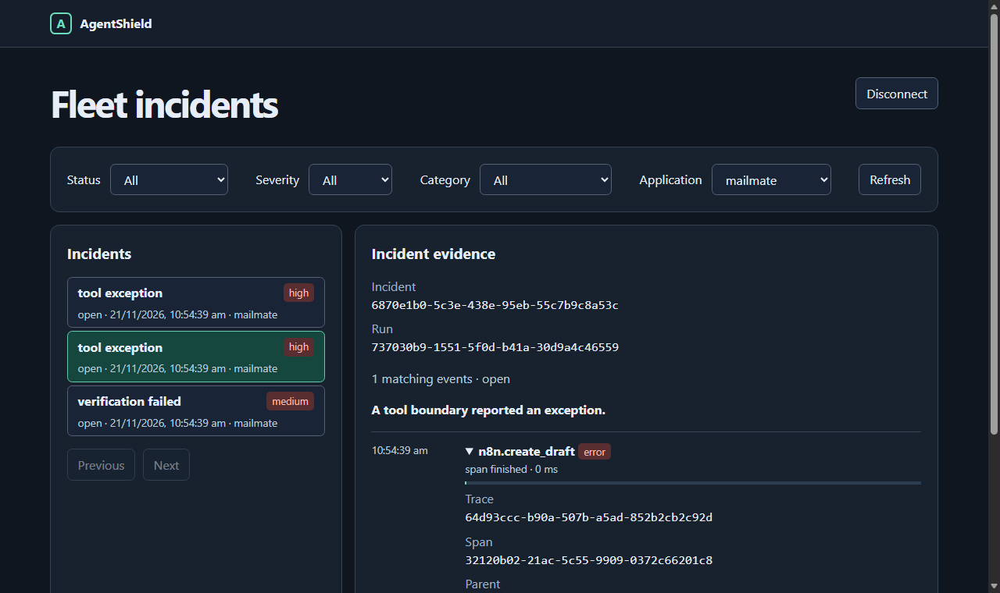

# Week 8 · Evaluation and packaging

## Start from a clean checkout

Docker Compose builds the React explorer and serves it with FastAPI on loopback. SQLite data persists in the project's named volume. From the repository root in PowerShell, generate two independent keys for this installation. Save them privately if you plan to keep using the same installation.

```powershell
$env:AGENTSHIELD_ADMIN_KEY = python -c "import secrets; print(secrets.token_urlsafe(32))"
$env:AGENTSHIELD_VIEWER_KEY = python -c "import secrets; print(secrets.token_urlsafe(32))"
docker compose up --build --wait
```

Open [the local explorer](http://127.0.0.1:8765/explorer/) and choose **Read-only fleet** with the viewer key. A new database has no applications or incidents. Register an application using the root README and use its returned key for ingestion. Stop the service with `docker compose down`.

For a source installation, use Python 3.12 and Node 24. The commands below use a disposable server for each demo.

```powershell
python -m venv .venv
.\.venv\Scripts\python -m pip install -r requirements.txt
npm.cmd --prefix frontend ci
npm.cmd --prefix frontend run build
.\.venv\Scripts\python -m pytest -q
.\.venv\Scripts\python -m examples.week1
.\.venv\Scripts\python -m examples.week6
```

The three-application demo additionally requires the three application checkouts and their Python environments. [Week 7 setup](week7.md)

## Architecture







[Watch the captioned fleet dashboard walkthrough](media/fleet-demo.webm).

## Regenerate the benchmark

```powershell
.\.venv\Scripts\python -m evals.benchmark --trials 2 --output .agentshield/offline.json
# With llama3.2:1b already installed on a loopback Ollama service
$env:AGENTSHIELD_OLLAMA_PORT = '11434'
.\.venv\Scripts\python -m evals.benchmark --trials 2 --model llama3.2:1b --output .agentshield/comparison.json
.\.venv\Scripts\python -m evals.audit --output .agentshield/factual-audit.json
```

The first command exercises the rules and specialized graph without inference. The second also runs the single-agent baseline and enables the graph's bounded local ranker. Each trial starts a fresh collector and SQLite database. Each case goes through the authenticated HTTP batch endpoint. The runner rejects a modified corpus checksum and records the model digest, per-case predictions, timing, errors, call counts and replay comparisons. Model weights and recorded output stay local. [Frozen cases](../evals/cases-v1.jsonl) · [Benchmark runner](../evals/benchmark.py)

The suite includes 25 RAG cases, 25 MONDAY cases, 20 MailMate cases, 15 blocked-action cases and 15 controls. Three cases are sanitized recordings of Week 7 demo executions. The other 97 use controlled telemetry with varied signals, nesting, ordering and thresholds. Cases include concurrent-looking contributors, successful parent operations, absence of required evidence, and an exact latency and retry boundary. The recorded traces are previously exercised integration cases. The synthetic variants share templates and existing detector concepts. This suite measures these conditions only.

### How scoring works

- **Detection** compares sets of incident categories per run. Precision counts correct categories among reported categories. Recall counts them among labelled categories. A clean false alarm is any incident on a labelled clean run. All investigation modes share the same detector.
- **Investigation** scores one predesignated focal incident per positive case. The evaluator uses its label to select the incident for investigation. The investigators receive the detected category and sanitized evidence. Cause labels and expected answers stay in the evaluator. Missing focal incidents count as misses on applicable recall and cause metrics.
- **Rules** report the detector anchor, identify directly recorded blocks and abstain from causal ranking. **Single agent** receives a bounded trace and returns at most three event indices plus an optional blocked-event index in one structured Ollama response. **Graph** executes the production triage, root-cause and conditional security-policy nodes. It calls Ollama only to rank competing candidates.
- **Top-1 and Top-3** use the known-cause subset. A hit requires the labelled contributing event in the first one or three positions. Cases with unknown causes have a separate abstention denominator. An invalid single-agent response counts as an error and earns no hit.
- **Evidence-label agreement** checks structured findings against the labelled evidence. Graph references must match event, span and trace. Cause findings must cite the labelled child and its failed parent. A reported block requires an explicit blocked-action flag. Triage and other policy findings are checked against the focal anchor.
- **Factual faithfulness** separately audits every graph finding marked `observed` in a model-free replay. It resolves the exact event, trace and span and checks whether those fields support the complete v1 sentence. Unrecognized wording and broken references count as unsupported. Cause hypotheses are scored by the ranking metrics. The optional Ollama ranker orders hypotheses only. The audit exports each statement and its references for human inspection. Reviewer usefulness has not been assessed.
- **Cost and latency** cover local HTTP ingest and investigation wall time. The report includes nearest-rank p95 ingest and median investigation time for each mode. Rules timing includes the evidence fetch, single-agent timing covers the inference request and graph timing includes the API and checkpoint writes. These different execution paths matter when interpreting latency. Local inference incurs zero external model fees. Electricity and hardware costs were not measured.
- **Repair** runs the existing Wasmtime catalogue once per benchmark invocation. The denominator is attempted fixture repairs. Regression rate uses previously passing control examples. The replay results measure those two catalogue changes. No proposal is deployed.

Graph call counts include ranker retries. The graph can complete a report using evidence order if ranking fails. Its error counter counts partial reports. The single-agent error counter counts failed requests, invalid responses and invalid references.

### Exit checks

The independent factual audit supported all 123 observed graph findings. Each row includes the statement, the event/trace/span references and the adjudication. [Factual audit results](../evals/results/v1-factual-audit.json)

The core starts with an empty database, accepts authenticated batches and serves the built explorer. The scripted benchmark must read 100 distinct frozen runs and write a result file. Model-free CI exercises the test suite, benchmark, Week 1 and Week 6 demos, and a Compose startup and ingestion check on Linux. Hosted CI status becomes available after you push. The full three-way comparison requires the named local model.

Local acceptance exercised both the Linux Compose image and a disposable Windows source tree with newly installed dependencies. The packaged collector returned 100 unique events, 10 filtered errors and 100 ignored duplicate submissions. The clean source run built the explorer, passed both scripted demos and passed 46 tests. Three integration tests skipped their unavailable application or live-model prerequisites in that clean tree.
